  

<!-- After you deploy the Three.js portfolio (see index.html), uncomment and fix the link:

-->

 

---

## About

I am a full-stack developer at **[Windguard IT Solutions](https://windguard-it-solutions.onrender.com)** with experience in software engineering. I work across the whole product: the interface in the browser, the application logic on the server, and the data underneath.

- Front end: HTML, CSS, JavaScript, React
- Back end: Node.js, Java, C, C++
- Data: PostgreSQL, MySQL, SQL Server, MongoDB
- Analysis: NumPy, Pandas, Matplotlib, Jupyter

 

---

## Tech stack

 

 

 

 

---

## GitHub activity

---

## Microsoft certificates

<table>
  <tr>
    <td></td>
    <td></td>
    <td></td>
  </tr>
  <tr>
    <td></td>
    <td></td>
    <td></td>
  </tr>
</table>

<b>Show more certificates</b>

 
<table>
  <tr>
    <td></td>
    <td></td>
    <td></td>
  </tr>
  <tr>
    <td></td>
    <td></td>
    <td></td>
  </tr>
</table>

---

